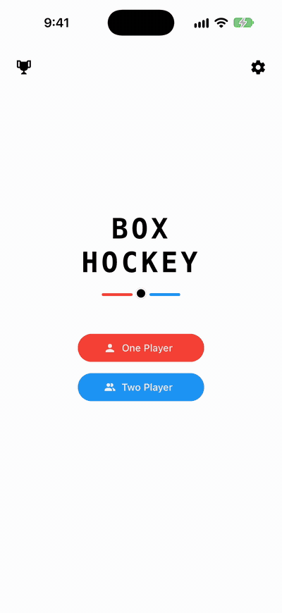

# PuckTastic

Four tabletop puck games in one app: Box Hockey, Air Hockey, Paddles and Breaker. Play a friend face to face on one device, or the CPU.

PuckTastic is a pack of physics-driven puck games for iOS, Android, and web, and the 2.0 of BoxHockey on the App Store. Built with Expo, React Native, and React Native Skia, it's part of a family of games built on my open-source `@tastic` game-engine and `@rific` Expo utility packages.

<p align="center"></p>

## The games

- **Box Hockey:** the classic wooden table game. Players take turns shooting the puck through the gaps and into the other player's goal.
  - Four ways to shoot, per player: Flick (power from swipe speed, the default), Pull (a slingshot: drag back, release to fire), Push (drag toward the shot), or Stick (swing your finger into the puck like a stick blade).
  - Three tip-offs: Face-Off (a reaction race: both players ready up, a 3-2-1 countdown runs, then one of each player's two circles lights after a random hold and the first correct tap wins the knock), Coin Flip, and Triple Tap (iOS and Android only: both players tap their own half three times in step, then race to swipe; a second swipe within a quarter second knocks the puck off its line).
  - Three boards: Classic (a center divider with two gaps), Gauntlet (three gapped walls) and Gravity (the divider plus a center attractor and four corner repellers). A Rink toggle adds rounded corners and a net pocket behind each goal.
  - Match options: puck speed, puck size, score to win, a shot preview that can draw predicted bank shots, and a Slap Shot setting for how early a player can hit a puck that's still sliding.
- **Air Hockey:** the arcade table classic. Both players play at once: your paddle goes straight to your finger, stays in your own half, and a faster swing hits harder. The score shows as arcs lit in front of each goal. Options: a Rink toggle (rounded corners and a pocket behind each goal), puck speed, puck size, paddle size, and score to win.
- **Paddles:** the arcade original, played with a puck. Your paddle lines up with your finger, and the puck speeds up a little with every hit. Options: paddle size, puck speed, score to win, and tilt steering when one person plays on a phone.
- **Breaker:** the classic brick breaker. Against the CPU or a friend, a block of bricks sits between the paddles and breaks when hit. With Nobody in seat 2, it's you against a whole field of bricks: clear every one before your 3 lives run out.

## Features

- **One app, one Home:** pick who's playing (seat 1), then a game from the list. Each game shows its How to Play cards the first time it's opened, and its rules button replays them.
- **Seat 2, kept across games:** each loadout's seat 2 button picks the CPU (Easy, Medium, or Hard, set per game), Player 2, a saved profile, or Nobody (Breaker only). It's saved for the whole pack, so the same two people stay set up from one game to the next. In 2 Player on a phone, the loadout and the match seat the two players face to face.
- **Player profiles:** saved names, colors, and tags. On iOS the roster is shared with my other games through an App Group. A profile's color pick for a seat is kept for this pack only.
- **Stats and achievements:** each game keeps its own stats and its own achievements (138 in all: Box Hockey 33, Air Hockey 33, Paddles 33, Breaker 39). One stats screen filters by player and by game, with per-profile and device-wide records, player rankings, and day streaks. Unlocks show as toasts; in 2 Player each player's toasts and Game Over card face them in their own half.
- **Desktop web:** in Air Hockey, Paddles and Breaker each seat plays with the mouse or a key cluster (WASD, the arrow keys, IJKL, or the numpad), picked in the loadout. Box Hockey shoots with the mouse and takes face-offs on the keys.
- **Settings:** sound, haptics, appearance, blur, Lock Orientation, Keep Awake, Edge Guard (an iOS option that makes system edge gestures need a second swipe during play), and Check for Updates. A match pauses when the app goes to the background and stays Paused until a player taps Resume.

## Under the hood

- **One pack, separate games:** `src/pack.ts` lists the games in Home's order and builds the one store. Each game in `src/games/<id>/` hands the app a single `GameDefinition` (its store slices, loadout options, play screen, stats sections, achievements, and How to Play), and the shared screens in `src/shell/` (Home, the loadout, stats, profiles) draw every game from those. A lint rule keeps the shell and shared code from importing any game, and one game from importing another, so a game can join or leave the pack on its own.
- **Saved data:** Redux Toolkit with redux-persist, one store with each game's settings, stats, achievements, and How to Play state under its own keys beside the pack-wide settings, seat 2, profiles, and seat colors. Per-round state is left out of persistence. A BoxHockey 1.0 save is imported once, on the first launch of a PuckTastic build, under the pack's key names. Over-the-air updates ship through `expo-updates`.
- **Box Hockey physics (`src/games/boxhockey/utils/physics.ts`):** a custom puck integrator built on `@tastic/physics` collision primitives (circle vs. rect, circle vs. circle, rounded corners, reflection, friction, gravity wells). Fast pucks are sub-stepped to avoid tunneling, a goal only counts once the puck's whole body has crossed the line, and goalposts are round so they deflect along a curve. With Rink on, the goal mouth is a one-way door: a puck can go in and around the pocket but can't come back out the front. A shot taken at a still-moving puck adds the puck's existing velocity to the shot.
- **Box Hockey's CPU plans by simulation:** it doesn't use an angle formula. It replays candidate shots through the same `stepPhysics` the game loop runs, over a grid of angles and power levels, and scores each result: a goal (fewer bounces and a straighter line rank higher), an own goal (discarded unless every candidate is one), or where the puck stops. Difficulty sets how wide it searches, whether it tries bank shots, how much it weighs defense, its aim and power noise, and its thinking time. It plays its turn through the same aim-and-shoot input path a human drag uses.
- **Face-off resolution (`src/games/boxhockey/utils/faceoff.ts`):** the winner's knock launches from center toward the loser's goal. The margin between the two presses sets the angle jitter (a close race gives a scrappier, wider knock), and the winner's own reaction time sets the power. Jitter is capped well under 90° so the knock can't head back toward the winner's own net, and the loser always takes the next real turn. The CPU's reaction times follow real human reaction-time ranges.
- **Turn-based reducer:** Box Hockey's `useGameState` reducer holds every phase (aiming, striking, simulating, scored, face-off, coin flip, triple tap, game over), driven by `@tastic/core`'s game loop. Random choices, timestamps, and the frame delta are all passed in by the caller, so the reducer stays deterministic and testable.
- **Air Hockey (`src/games/airhockey/`):** both paddles and the puck are live at once. A paddle's velocity comes from how far it moved since the last tick and is added to the puck on contact, capped at a top paddle speed. The CPU watches and adjusts instead of planning: it predicts the puck's straight-line position a short time ahead, blurs its aim by difficulty, caps how fast its paddle can get there (which alone gives it believable reaction lag), and eases back toward its own goal when the puck isn't a threat. With Rink on, a puck that comes to rest in the pocket behind a goal is served again.
- **Paddles and Breaker (`src/shared/paddleGame/`):** one engine for both. The puck has no friction: its speed tier sets the serve speed and how much each paddle hit adds, and its speed is tracked as one number so many hits in a row can't drift. Bricks bounce the puck with a little random jitter, so a partly cleared field can't trap it in a loop, and they don't speed it up. The CPU tracks the puck the same watch-and-adjust way as Air Hockey's.
- **Board geometry:** each game's board is sized from the screen and its puck and paddle settings, so every size stays playable. On native and mobile web a board fills the screen edge to edge; desktop web gives each board a fixed table shape. The OS stays locked to portrait and the app draws its own rotation, following how the device is held.
- **Skia rendering across platforms:** the boards, pucks, paddles, bricks, score wedges, goal celebrations, gravity-well swirls, and the coin flip are drawn with React Native Skia and `@tastic/sprites`. On the web each board loads only once CanvasKit (WASM) is ready; on native it draws on the first frame.
- **Tests:** 48 Jest suites with 710 tests covering each game's physics and board geometry, the AI opponents, face-off knocks, the slap-shot and Stick paths, Triple Tap sequencing, a turn-alternation fuzz test, bricks and lives, stats and achievements for every game, the How to Play copy, the store and its migrations, background pause, and profile syncing.

## Built on

| Package | Used for |
| --- | --- |
| [`@tastic/core`](https://github.com/jayrdeaton/React-Native-Game-Core) | Game loop, orientation and rotation handling, settled window sizing for the web canvas, background pause, config plugin for the native portrait lock |
| [`@tastic/physics`](https://www.npmjs.com/package/@tastic/physics) | Circle/rect/rounded-corner collision, reflection, friction, gravity wells, goal-wedge geometry |
| [`@tastic/input`](https://www.npmjs.com/package/@tastic/input) | Drag-to-aim vector math, desktop key schemes |
| [`@tastic/split-screen`](https://www.npmjs.com/package/@tastic/split-screen) | Two-player loadout zone layout (face-to-face vs side-by-side) |
| [`@tastic/hud`](https://www.npmjs.com/package/@tastic/hud) | Player setup panels, dropdowns, settings, confirm and update dialogs, stats screen sections, how-to-play guide, Skia web loader |
| [`@tastic/sprites`](https://www.npmjs.com/package/@tastic/sprites) | Skia board shapes, hockey rink visuals (score wedges, goal-door flash, zone lines), gravity-well swirl |
| [`@tastic/profile`](https://www.npmjs.com/package/@tastic/profile) | Player profiles, pickers, roster screen, per-profile extensions, shared App Group sync |
| [`@tastic/achievements`](https://www.npmjs.com/package/@tastic/achievements) | Tiered achievement catalogs, streak tracking, Redux-backed persistence |
| [`@tastic/edge-guard`](https://www.npmjs.com/package/@tastic/edge-guard) | Optional guard against iOS edge system gestures during play |
| [`@rific/core`](https://www.npmjs.com/package/@rific/core) | Redux settings slice factory, safe back navigation, Keep Awake |
| [`@rific/auto-paper`](https://www.npmjs.com/package/@rific/auto-paper) | React Native Paper theming from seed colors, light/dark appearance |
| [`@rific/feedback-press`](https://www.npmjs.com/package/@rific/feedback-press) | Buttons with haptic and sound feedback, vibration, game sounds |
| [`@rific/toaster`](https://www.npmjs.com/package/@rific/toaster) | Toast notifications (achievement unlocks, update errors) |
| [`@rific/splash-gate`](https://www.npmjs.com/package/@rific/splash-gate) | Keeps the splash screen up until the theme, fonts, and profiles are ready |
| [`@rific/updater`](https://www.npmjs.com/package/@rific/updater) | OTA update checks |
| [`@rific/focus-chain`](https://www.npmjs.com/package/@rific/focus-chain) | Peer dependency of `@tastic/profile` for form focus |
| [`@rific/gestures`](https://www.npmjs.com/package/@rific/gestures) | Peer dependency of `@tastic/profile` and `@rific/toaster` |

## Getting started

```bash
npm install
npm run ios        # or: npm run android / npm start (web)
```

The app uses native code that Expo Go doesn't include (the `@tastic/core` and `@tastic/edge-guard` config plugins and `@tastic/profile`'s native iOS shared-roster module), so iOS and Android run as a development build (`expo-dev-client`). `npm run ios` and `npm run android` build it locally (`expo run:*`), and `npm run client` starts the dev server for an already-installed build. `npm install` also runs `setup-skia-web` (the `postinstall` script), which copies Skia's CanvasKit WASM into `public/` for the web target.

### Checks

```bash
npm run verify     # lint (expo lint) + Jest + typecheck (tsc)
```

CI runs the same command on pushes and pull requests to `main`. `npm run build` and `npm run update` are plain `eas build` and `eas update` and don't run it, so run it first. `npm run build:web` runs it, then exports the web build.

## Project layout

```
src/
  app/          expo-router routes: home, stats, profiles, and each game's loadout and play screens
  pack.ts       the pack's name, its games in Home's order, and the store
  shell/        app-wide screens (home, loadout, stats, profiles), providers, settings, and store slices
  shared/       code two or more games use: stats, result cards, unlock toasts, and the paddle-game engine
  games/        one folder per game: boxhockey, airhockey, paddles, breaker
  constants/    release info for over-the-air updates
  testUtils/    shared test helpers
  __tests__/    Jest suites for the pack and Box Hockey (each other game keeps its own beside its code)
  __mocks__/    manual mocks for native and Expo modules
```

## License

The code is released under the MIT License, see [LICENSE](LICENSE).

The game's name, logo, and icons, and the original artwork and audio in this repository, are not covered by that license and remain all rights reserved. If you fork it, please give your version its own name and look.
